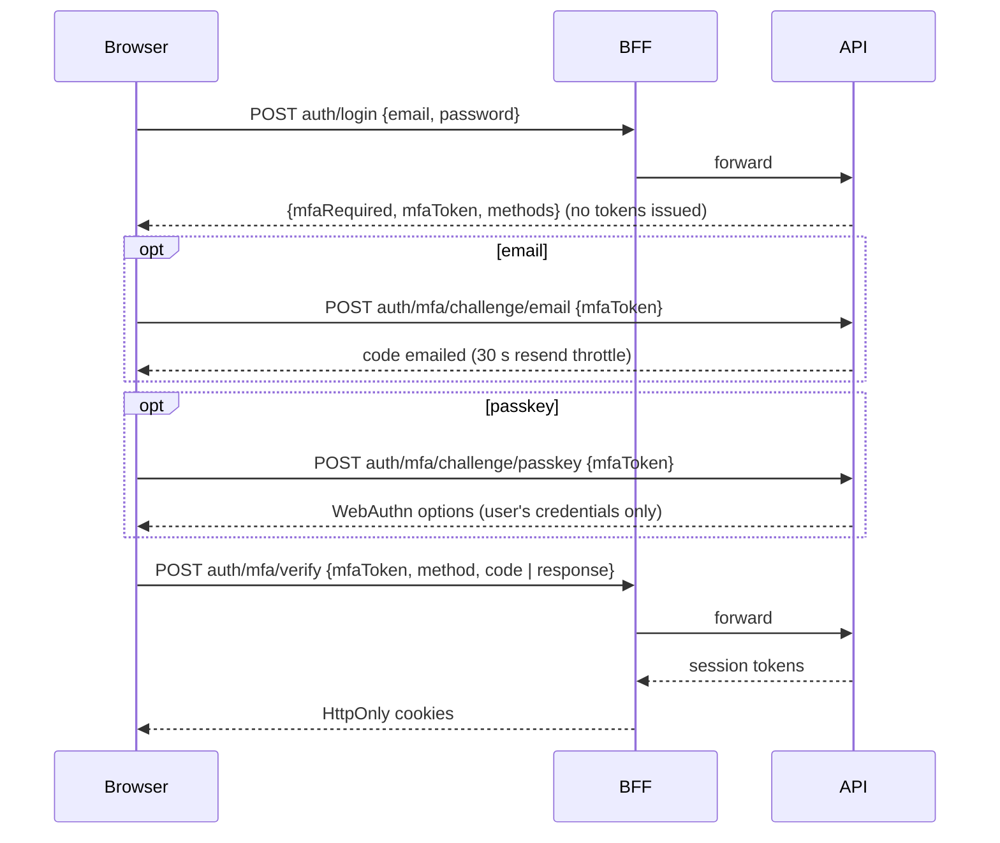

# 2-step verification (MFA)

Opt-in per user. Factors: **authenticator app (TOTP)**, **email code**, **passkey**, plus
**recovery codes** as a backup. MFA applies to _password_ logins. A passkey login
(`/auth/passkeys/login/*`) already combines possession and user verification, so it skips the second step.

## Login flow

The `mfaToken` is 256-bit random, stored only as an HMAC (`mfa_challenges`), valid for
`MFA_TOKEN_TTL` (default 10 min), and single-use. After **5** wrong attempts it is destroyed, so the
password has to be entered again, which is itself rate-limited and covered by the lockout.

## API (`/api/v1/auth/mfa`)

| Method & path                                | Auth     | Body                                                                               |
| -------------------------------------------- | -------- | ---------------------------------------------------------------------------------- |
| `POST /verify`                               | mfaToken | `{ mfaToken, method: totp\|email\|passkey\|recovery, code?, response? }` → session |
| `POST /challenge/email`                      | mfaToken | `{ mfaToken }`                                                                     |
| `POST /challenge/passkey`                    | mfaToken | `{ mfaToken }` → WebAuthn options                                                  |
| `GET /`                                      | Bearer   | → `{ enabled, totp, email, passkey, passkeyCount, recoveryCodesRemaining }`        |
| `POST /totp/setup`                           | Bearer   | `{ currentPassword }` → `{ secret, otpauthUrl }` (pending until confirmed)         |
| `POST /totp/enable`                          | Bearer   | `{ code }` → `{ recoveryCodes? }`                                                  |
| `POST /email/enable`, `POST /passkey/enable` | Bearer   | `{ currentPassword }` → `{ recoveryCodes? }`                                       |
| `POST /{totp\|email\|passkey}/disable`       | Bearer   | `{ currentPassword }`                                                              |
| `POST /recovery-codes`                       | Bearer   | `{ currentPassword }` → `{ recoveryCodes }`                                        |

`recoveryCodes` (10 codes, `XXXXX-XXXXX`) is returned only when the first factor is turned on, or on
regeneration. It is never shown again.

## Storage

- `users.mfa_totp_secret`: AES-256-GCM encrypted. The key comes from `MFA_ENCRYPTION_KEY` (HKDF),
  falling back to `JWT_REFRESH_SECRET`. Rotating the key invalidates enrolled apps.
- `users.mfa_totp_last_step`: the last accepted 30-second step. A code can't be reused, and a
  conditional update stops two concurrent requests from both using it.
- `users.mfa_{totp,email,passkey}_enabled_at`.
- `mfa_recovery_codes`: HMAC hashes and `used_at`.
- `mfa_challenges`: login tickets, attempt counts, the hashed email code and the passkey challenge.

## Rules

- Enabling or disabling a factor and regenerating codes all require the current password.
  TOTP turns on only after a valid code proves the app holds the secret.
- Turning off the last factor deletes the recovery codes.
- With passkey MFA on, the last passkey can't be removed (409). Turn passkey MFA off first.
- Password reset still works for recovery. It does **not** turn MFA off, so a mailbox compromise alone
  isn't enough to sign in to a TOTP- or passkey-protected account.
- Codes, tokens and `mfaToken` are redacted from logs. Audit events: `mfa.enabled`, `mfa.disabled`,
  `mfa.verified`, `mfa.failed`, `mfa.recovery_regenerated`.
- TOTP is RFC 6238 (SHA-1, 6 digits, 30 s, ±1 step), built on Node `crypto` and checked against the RFC
  test vectors (`tests/unit/totp.test.ts`).

## Production notes

`sendMfaCodeEmail` in `src/shared/utils/mailer.ts` only logs the code outside production and warns in
production. Wire a real mail provider there, as with password reset, before enabling email codes.
