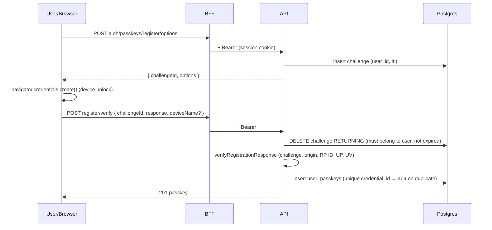

# Passkeys (WebAuthn)

Passwordless sign-in alongside the existing email/password login. Built on
`@simplewebauthn/server` (backend) and `@simplewebauthn/browser` (frontend). Password login,
refresh rotation and all guards are unchanged; a passkey login ends in the same session as a
password login (`authService.startSession`).

## Architecture

```
Browser ──fetch /api/auth/passkeys/*──▶ Next.js BFF (route.ts) ──Bearer──▶ Fastify /api/v1/auth/passkeys/*
   ▲  navigator.credentials.create/get                │ stores tokens in HttpOnly cookies
   └── authenticator (Touch ID, Windows Hello, phone, security key)
```

| Piece                               | File                                                                    |
| ----------------------------------- | ----------------------------------------------------------------------- |
| Routes + validation + audit logs    | `src/modules/auth/passkey.routes.ts`                                    |
| Ceremonies, verification, ownership | `src/modules/auth/passkey.service.ts`                                   |
| DB access                           | `src/modules/auth/passkey.repository.ts`                                |
| Config + startup validation         | `src/config/env.ts`, `src/config/app.config.ts` (`parsePasskeyOrigins`) |
| Migration                           | `src/database/migrations/20260101000006_create_user_passkeys.ts`        |
| Frontend helpers                    | `main-frontend/src/features/auth/passkey.ts`                            |
| Login button / settings card        | `login-form.tsx`, `features/settings/passkeys-card.tsx`                 |

**Challenge storage.** The project has no Redis, so challenges live in Postgres (`passkey_challenges`).
Each options call inserts one row and returns its `challengeId`. Verify deletes it with
`DELETE … RETURNING`, which makes it single-use (a replay finds nothing) and keeps concurrent attempts
apart. Expired rows are removed whenever a new challenge is issued.

## Registration flow



## Login flow

```mermaid
sequenceDiagram
  participant U as User/Browser
  participant F as BFF
  participant A as API
  participant D as Postgres
  U->>F: POST auth/passkeys/login/options { email? }
  F->>A: forward (public)
  A->>D: insert challenge (user_id if email has passkeys, else null)
  A-->>U: { challengeId, options }  (allowCredentials only with known email)
  U->>U: navigator.credentials.get()
  U->>F: POST login/verify { challengeId, response, tenantSlug? }
  F->>A: forward
  A->>D: consume challenge; find passkey by credential id
  A->>A: verifyAuthenticationResponse (signature, counter, origin, RP ID, UV)
  A->>D: check user active; update counter + last_used_at
  A-->>F: tokens + user/tenant
  F-->>U: set HttpOnly cookies, strip tokens from body
```

## API (`/api/v1/auth/passkeys`)

| Method & path            | Auth   | Body                                     | Result                                                                                   |
| ------------------------ | ------ | ---------------------------------------- | ---------------------------------------------------------------------------------------- |
| `POST /register/options` | Bearer | –                                        | `{ challengeId, options }`                                                               |
| `POST /register/verify`  | Bearer | `{ challengeId, response, deviceName? }` | `201` passkey                                                                            |
| `POST /login/options`    | –      | `{ email? }`                             | `{ challengeId, options }`                                                               |
| `POST /login/verify`     | –      | `{ challengeId, response, tenantSlug? }` | session (same as `/auth/login`)                                                          |
| `GET /`                  | Bearer | –                                        | passkeys `[{ id, deviceName, deviceType, backedUp, transports, createdAt, lastUsedAt }]` |
| `PATCH /:id`             | Bearer | `{ deviceName }`                         | passkey                                                                                  |
| `DELETE /:id`            | Bearer | `{ currentPassword }`                    | `null`                                                                                   |

Errors use the normal envelope `{ success:false, message, errors }`:

| Status | Message                            | Cause                                                                               |
| ------ | ---------------------------------- | ----------------------------------------------------------------------------------- |
| 400    | Passkey request expired or invalid | missing, expired, replayed or other user's challenge                                |
| 400    | Passkey verification failed        | registration failed: origin, RP ID, challenge, UV or attestation                    |
| 401    | Passkey sign-in failed             | unknown credential, bad signature, wrong origin/RP ID/challenge, counter regression |
| 403    | Account is deactivated             | valid passkey, inactive user                                                        |
| 409    | This passkey is already registered | duplicate credential                                                                |
| 404    | Passkey not found                  | not yours or doesn't exist                                                          |

Responses say only that a step failed, never which cryptographic check failed. Login endpoints and
registration/delete use the strict `AUTH_RATE_LIMIT_MAX` per-IP limit.

## Database

`user_passkeys`: `id uuid pk`, `user_id → users (cascade)`, `credential_id text unique` (base64url),
`public_key bytea` (COSE), `counter bigint`, `transports jsonb`, `device_type`, `backed_up`,
`device_name null`, `created_at`, `updated_at` (trigger), `last_used_at`. Indexed on `user_id`.
Only public keys are stored. Private keys and biometrics never leave the authenticator.

`passkey_challenges`: `id`, `purpose`, `challenge`, `user_id null`, `expires_at` (indexed).

## Configuration

| Var                         | Default                 | Notes                                                                                                    |
| --------------------------- | ----------------------- | -------------------------------------------------------------------------------------------------------- |
| `RP_NAME`                   | `APP_NAME`              | Shown in the browser prompt                                                                              |
| `RP_ID`                     | `localhost`             | Registrable domain, no scheme/port, e.g. `example.com`                                                   |
| `EXPECTED_ORIGIN`           | `http://localhost:3000` | Comma-separated frontend origins. Each host must equal or end with `.RP_ID`. Must be https in production |
| `PASSKEY_CHALLENGE_TTL`     | `300`                   | Seconds (30–600)                                                                                         |
| `PASSKEY_USER_VERIFICATION` | `required`              | `required` or `preferred`                                                                                |

Startup fails on an invalid combination. Passkeys are bound to `RP_ID`: changing it later invalidates
every registered passkey.

## Local development

`npm run db:migrate`, then run both apps. Browsers allow WebAuthn on `http://localhost` without TLS.
Open the frontend on `localhost`, not `127.0.0.1`, or the RP ID won't match. Without a real authenticator,
use Chrome DevTools → More tools → WebAuthn → "Enable virtual authenticator environment".

## Production

- Serve the frontend over HTTPS and set `RP_ID` / `EXPECTED_ORIGIN` to the real domain.
- The BFF already sets the session cookies `HttpOnly`, `SameSite=Lax` and `Secure` (in production).
  Together with JSON-only request bodies, this is the CSRF defence.
- Set `TRUST_PROXY=true` behind Nginx so the per-IP rate limits and audit logs see the real client IP.

## Browser compatibility

Supported in current Chrome, Edge, Safari (macOS/iOS 16+) and Firefox. Synced passkeys come from iCloud
Keychain and Google Password Manager. Cross-device sign-in works via QR code and phone. Where WebAuthn is
missing, the UI hides the passkey button and says so on the settings page.

## Account recovery

Every account keeps its password, so the password login and `/auth/forgot-password` email reset remain
the recovery path. That is also why removing the last passkey is allowed. Removing a passkey requires the
current password.

## Security notes

- The server verifies everything: challenge, origin (explicit allow-list), RP ID hash, user presence,
  user verification (per config) and signature. The sign counter must increase.
- Challenges come from SimpleWebAuthn (CSPRNG), are single-use, short-lived, and bound to a user where
  one is known.
- Ownership comes from the stored credential row. A user ID from the client is never used.
- Account status is checked after the signature, so it isn't revealed to non-owners. The password-lockout
  counter does not block passkey login, which would otherwise let anyone lock a user out.
- Audit log events (pino, `audit` field): `passkey.registered`, `passkey.register_failed`,
  `passkey.login`, `passkey.login_failed`, `passkey.removed`.
- Removing a passkey does not end existing sessions. Use "Sign out everywhere" if a device was lost.

## Tests

`tests/integration/passkeys.test.ts` drives real ceremonies through a software ES256 authenticator
(`tests/helpers/soft-authenticator.ts`). It covers registration, duplicates, wrong origin/RP ID/challenge,
missing UV, login (discoverable and email), invalid signature, unknown credential, expired challenges,
replay, disabled users, concurrency, and ownership in rename/remove. `tests/unit/passkey-config.test.ts`
covers config validation.
